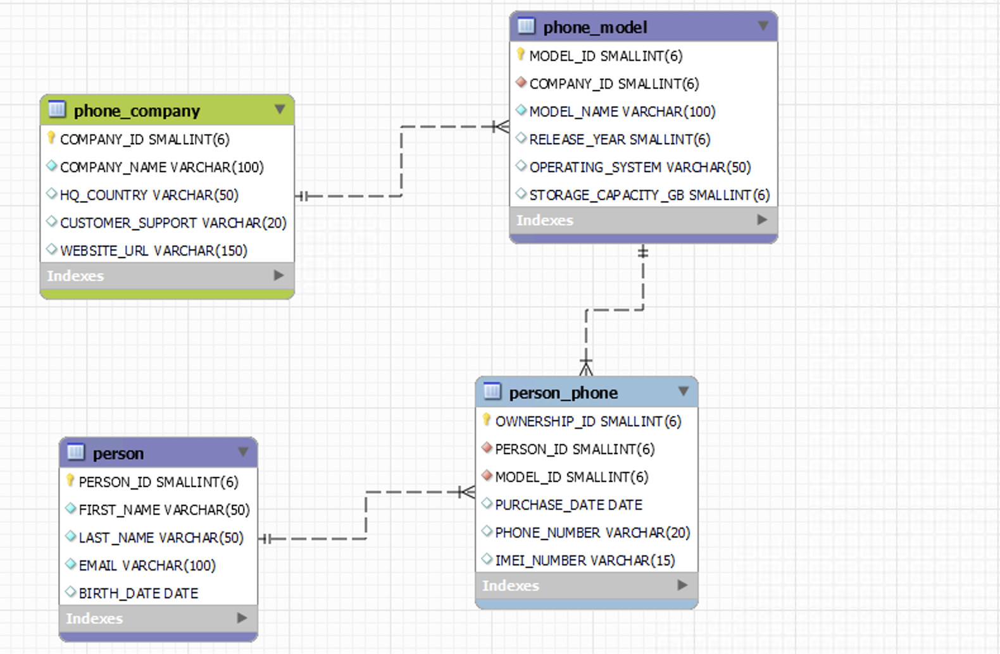

# Personal Mobile Phone Inventory Data Model

A relational database design for tracking personal mobile phones, their owners, models, and manufacturers. This individual SQL data architecture assignment models the relationship between people and phone models through an ownership table.



## My contribution

I designed the four-entity model, created the MySQL DDL, and documented its relationships and intended uses in the assignment. The diagram was created in MySQL Workbench. The submission also includes sample records for the four tables.

## Data model

- **PERSON** holds owner details, including a unique email address.
- **PHONE_COMPANY** holds manufacturer information.
- **PHONE_MODEL** belongs to one company; a company can have many models.
- **PERSON_PHONE** connects people and models, recording ownership details such as purchase date, phone number, and IMEI. It resolves the many-to-many relationship between people and models.

The model can support queries about owners, models, manufacturers, and purchase history. These are intended uses of the design; no query results or deployed application are included.

## Tools and files

- MySQL and MySQL Workbench
- [`sql/schema.sql`](sql/schema.sql): database and table creation statements transcribed from the submitted assignment.
- [`sql/sample-data.sql`](sql/sample-data.sql): sample inserts from the submitted assignment.
- [`assets/phone-inventory-erd.png`](assets/phone-inventory-erd.png): entity relationship diagram.

## Run the schema

Use a MySQL server and client with permission to create a database. From the repository root, run:

```sh
mysql -u YOUR_USERNAME -p < sql/schema.sql
```

The script creates and selects `PhoneAssignment`, then creates the four tables. Run it against a fresh database: it does not drop existing data or use `IF NOT EXISTS`, so it will fail if the database already exists. To load the submitted sample records after creating the schema, run `mysql -u YOUR_USERNAME -p < sql/sample-data.sql`. The inserts use explicit IDs and are intended to be loaded once into empty tables. No credentials are stored in the repository. The original submission does not specify a MySQL version, and the script has not been tested against a running server in this workspace.

## Outcome and context

The submitted assignment documents a schema with four tables and the relationships shown above. It also records assessment scores for individual sections; those scores are not evidence of a production deployment or measured operational results. This was an individual academic assignment for SQL Based Data Architectures. No collaborator credits are identified in the available submission.
